# Resolução do Desafio SAEP: Sistema de Gestão para Clínica Veterinária

**Avaliação Prática de Desempenho dos Estudantes — SAEP**

**Tecnologias:** PHP 8.5, PostgreSQL, PDO com consultas preparadas  
**Arquitetura:** MVC artesanal, autoload de classes do namespace `App`

---

## Apresentação do Projeto e Visão Geral

Esse documento apresenta a resolução do desafio de desenvolvimento de um sistema para organizar tutores, pets e agendamentos de uma clínica veterinária.

O **VetCare** substitui controles manuais por uma aplicação web com autenticação, gestão de cadastros e consultas e proteção do CPF dos tutores por criptografia no banco de dados.

## Entregas

### Identificação do projeto

- **Nome do sistema:** VetCare — Sistema de Gestão para Clínica Veterinária
- **Público-alvo:** equipe da clínica, incluindo recepção, veterinários e gestores
- **Problema atendido:** reduzir perda e duplicidade de registros, organizar consultas e proteger dados pessoais dos tutores

### Requisitos Funcionais (RF)

- **RF-01 — Autenticação:** autenticar a equipe por e-mail e senha e informar falhas de login.
- **RF-02 — Sessão e saída:** manter a sessão do usuário, encerrá-la após 30 minutos de inatividade e oferecer a opção de sair.
- **RF-03 — Painel principal:** exibir o nome do usuário autenticado, totais dos cadastros e atalhos para os recursos do sistema.
- **RF-04 — Cadastro de tutores:** cadastrar nome, contato, endereço e CPF, armazenando o CPF criptografado.
- **RF-05 — Busca e listagem de tutores:** pesquisar tutores por nome, e-mail ou telefone e listar os resultados.
- **RF-06 — Edição de tutores:** permitir alterar os dados cadastrados e salvar as alterações no banco.
- **RF-07 — Cadastro de pets:** cadastrar pets e associar cada pet obrigatoriamente a um tutor.
- **RF-08 — Listagem de pets:** apresentar os pets cadastrados junto ao nome do respectivo tutor.
- **RF-09 — Agendamentos:** cadastrar consultas para um pet e listar os próximos atendimentos por data e hora, exibindo informações do pet e do tutor.
- **RF-10 — Atualização de agendamento:** permitir alterar a data e a hora de uma consulta e salvar a alteração.
- **RF-11 — Consultas realizadas:** apresentar separadamente os agendamentos cuja data e hora já passaram.
- **RF-12 — Exclusão de agendamento:** permitir apagar uma consulta após confirmação do usuário.
- **RF-13 — Exclusão de tutor:** permitir excluir tutores sem pets associados, preservando a integridade dos cadastros relacionados.

### Diagrama de Entidades Relacionais (DER)

```mermaid
erDiagram
    USUARIO {
        bigint id PK
        varchar nome
        varchar email UK
        varchar senha_hash
        timestamptz criado_em
    }

    TUTOR {
        bigint id PK
        varchar nome
        varchar email
        varchar telefone
        varchar endereco
        bytea cpf_criptografado
        timestamptz criado_em
    }

    PET {
        bigint id PK
        varchar nome
        varchar especie
        varchar raca
        date data_nascimento
        bigint tutor_id FK
        timestamptz criado_em
    }

    AGENDAMENTO {
        bigint id PK
        bigint pet_id FK
        timestamp data_hora
        varchar motivo
        varchar status
        varchar observacoes
        timestamptz criado_em
    }

    TUTOR ||--o{ PET : "possui"
    PET ||--o{ AGENDAMENTO : "recebe"
```



`usuario` autentica a equipe e é independente dos registros clínicos. O tutor relacionado a um agendamento é encontrado por meio do pet.

## Banco de Dados

O arquivo [`saep_db.sql`](saep_db.sql) cria as tabelas `usuario`, `tutor`, `pet` e `agendamento`, define as chaves primárias e estrangeiras e insere três registros de demonstração em cada tabela. Também habilita a extensão PostgreSQL `pgcrypto`, usada para a criptografia do CPF e os hashes de senha.

### Credenciais de demonstração

Todas as contas de demonstração usam a senha `admin123`.

| E-mail | Usuário |
|---|---|
| `ana@clinica.test` | Ana Souza |
| `bruno@clinica.test` | Bruno Lima |
| `carla@clinica.test` | Carla Mendes |

## Instalação e Execução (Windows)

Pré-requisitos: PHP 8.1 ou superior com `PDO`, `pdo_pgsql`, `pgsql` e `openssl`; PostgreSQL 13 ou superior com `pgcrypto`.

1. Abra o PowerShell na pasta `PROVASAEP` e crie o banco:

   ```powershell
   psql -U postgres -c "CREATE DATABASE saep_db1;"
   ```

2. Crie e povoe as tabelas:

   ```powershell
   psql -U postgres -d saep_db1 -f .\saep_db.sql
   ```

   Se o script já foi aplicado e os acentos aparecem incorretamente, execute-o novamente. Ele corrige os textos com codificação incorreta sem apagar os cadastros existentes.

3. Crie o arquivo local de configuração a partir do exemplo:

   ```powershell
   Copy-Item .\sistema\config\database.example.ini .\sistema\config\database.ini
   ```

   Edite `sistema/config/database.ini` com os dados do seu banco e uma chave de criptografia aleatória. Esse arquivo é ignorado pelo Git para evitar publicar credenciais.

4. Inicie o servidor local:

   ```powershell
   Set-Location .\sistema
   php -S 127.0.0.1:8000 -t public
   ```

5. Acesse <http://127.0.0.1:8000> e entre com uma das contas de demonstração.


## Testes dos Requisitos Funcionais

Execute os testes com o banco populado e o servidor iniciado. Para operações que alteram ou removem dados, prefira registros identificados como “Teste”.

| ID | Requisito | Procedimento | Resultado esperado |
|---|---|---|---|
| **TF-01** | RF-01 — Login válido | Entre com `ana@clinica.test` e `admin123`. | O acesso é aceito e o painel principal aparece. |
| **TF-02** | RF-01 — Falha de login | Informe uma senha incorreta na tela de login. | O acesso é negado e uma mensagem informa que o e-mail ou a senha são inválidos. |
| **TF-03** | RF-02 e RF-03 — Painel e saída | Após entrar, confira o nome, os totais e os atalhos; depois clique em Sair. | O painel identifica o usuário e a saída encerra a sessão, retornando ao login. |
| **TF-04** | RF-05 — Busca de tutores | Abra tutores, pesquise Mariana e confirme. | A listagem exibe os registros correspondentes ao termo. |
| **TF-05** | RF-04 e RF-06 — Cadastro e edição de tutor | Cadastre um tutor de teste; depois altere seu telefone ou endereço e salve. | O tutor aparece na listagem e, após edição, os novos dados ficam salvos. |
| **TF-06** | RF-07 e RF-08 — Pet associado a tutor | Cadastre um pet de teste, selecione um tutor e confira a listagem de pets. | O pet aparece na listagem associado ao tutor escolhido. |
| **TF-07** | RF-07 — Tutor obrigatório | Tente enviar o formulário de pet sem escolher um tutor. | O formulário não é enviado e nenhum pet sem tutor é cadastrado. |
| **TF-08** | RF-09 — Listagem de agendamentos | Crie dois agendamentos futuros com datas diferentes e abra Agendamentos. | Os atendimentos são ordenados por data/hora e exibem os dados do pet e do tutor. |
| **TF-09** | RF-10 e RF-11 — Reagendamento e consulta realizada | Altere a data de um agendamento de teste para uma data passada. | A nova data é salva e o atendimento aparece em Agendamentos já realizados. |
| **TF-10** | RF-12 — Exclusão | Clique em Apagar agendamento em um registro de teste e confirme. | O agendamento é removido; se cancelar a confirmação, ele permanece. |
| **TF-11** | RF-04 — CPF e senha protegidos | Cadastre um tutor de teste com CPF fictício e confira `cpf_criptografado` no banco; verifique também se a senha do usuário está armazenada como hash. | O CPF não aparece na listagem nem em texto puro no banco; as senhas são armazenadas com hash e o login valida esse hash. |
| **TF-12** | RF-02 — Expiração da sessão | Faça login e aguarde 30 minutos sem usar o sistema; em ambiente de teste, também é possível reduzir temporariamente o limite no código. | Ao acessar novamente uma área protegida, o sistema encerra a sessão e solicita novo login. |

## Estrutura do Projeto

```text
PROVASAEP/
├── README.md
├── saep_db.sql
├── der.png
├── der.svg
└── sistema/
    ├── config/database.ini
    ├── public/
    │   ├── index.php
    │   └── assets/style.css
    ├── src/
    │   ├── Controller/
    │   ├── Core/
    │   ├── Model/
    │   └── views/
```

